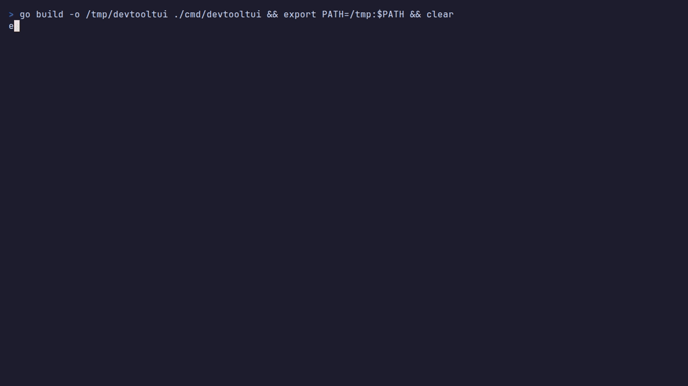

# devtooltui

Utilidades diarias de desarrollo —formatear JSON, decodificar JWT, Base64,
hashes, regex, diff…— en **un solo binario**: una TUI navegable con teclado y
una CLI componible con pipes. Funciona offline y sin telemetría. Inspirado en
[DevToys](https://github.com/DevToys-app/DevToys), pensado para la terminal.



## Instalación

```bash
# Homebrew (macOS y Linux)
brew install --cask Judamaro/tap/devtooltui

# Go ≥ 1.26
go install github.com/Judamaro/devtooltui-golang/cmd/devtooltui@latest
```

También hay binarios para Linux, macOS y Windows (amd64 y arm64) y paquetes
`.deb`, `.rpm` y `.apk` en [Releases](https://github.com/Judamaro/devtooltui-golang/releases).

En Linux, el portapapeles necesita `wl-clipboard` (Wayland) o `xclip`/`xsel`
(X11). Sin ellos, y por SSH, copiar usa OSC 52.

## Herramientas

| ID | Herramienta | Qué hace |
| --- | --- | --- |
| `json-format` | JSON | Indenta, minifica y ordena claves; errores con línea y columna |
| `xml-format` | XML | Indenta o minifica conservando comentarios, CDATA y DOCTYPE |
| `base64` | Base64 | Estándar o URL-safe, con o sin padding; binario como hex |
| `url` | URL | Encode/decode (query o path) y desglose de la URL |
| `jwt` | JWT | Header, payload y fechas; verifica HS* con secreto y RS/PS/ES/EdDSA con PEM |
| `timestamp` | Timestamp | Unix (s/ms/µs/ns) ↔ ISO 8601/RFC 1123, en cualquier zona IANA |
| `number-base` | Bases numéricas | Binario, octal, decimal y hex de cualquier tamaño |
| `json-yaml` | JSON ↔ YAML | Conserva el orden de las claves; anchors y merge keys |
| `hash` | Hash | MD5, SHA-1, SHA-256, SHA-512 y HMAC |
| `uuid` | UUID / ULID | Genera v4, v7 o ULID; inspecciona versión y fecha |
| `regex` | RegEx | RE2 con coincidencias resaltadas y grupos |
| `diff` | Diff | Por líneas (unificado o lado a lado) o por palabras |

## TUI

```bash
devtooltui              # abre la TUI
devtooltui --clipboard  # abre la herramienta que corresponde al portapapeles
```

| Tecla | Acción |
| --- | --- |
| `Tab` / `Shift+Tab` | Rotar el foco: sidebar, opciones, entradas, salida |
| `Ctrl+P` | Paleta: buscar herramienta o acción |
| `/` | Filtrar el sidebar |
| `Ctrl+Y` / `Ctrl+O` | Copiar la salida / pegar en la entrada |
| `Ctrl+D` | Detectar el portapapeles y saltar a la herramienta |
| `Ctrl+R` | Usar la salida como entrada (encadenar) |
| `Ctrl+E` | Editar la entrada en `$EDITOR` |
| `Ctrl+S` | Guardar la salida en un archivo |
| `Ctrl+L` | Limpiar la entrada |
| `Ctrl+B` | Mostrar u ocultar el sidebar |
| `F5` | Ejecutar (entradas grandes o herramientas no-live) |
| `?` | Todos los atajos |
| `q` / `Ctrl+C` | Salir (`q` fuera de los campos de texto) |

Las entradas de más de 32 KB pasan a modo de solo lectura (se recalculan con
`F5` y se editan con `Ctrl+E`); ver [ADR 0002](docs/adr/0002-live-max-bytes.md).

## CLI

Cada herramienta es un subcomando; sus opciones son flags.

```bash
devtooltui list [--json]
devtooltui detect token.txt                 # → jwt (0.98)
cat data.json | devtooltui json-format --sort-keys --indent 4
devtooltui base64 decode <<< 'aG9sYQ=='
devtooltui jwt --secret "$KEY" < token.txt
devtooltui jwt token.txt public.pem
devtooltui hash --algo sha256 archivo.bin
devtooltui diff a.txt b.txt
devtooltui regex --pattern '\d{4}-\d{2}' log.txt
devtooltui uuid --version v7 --count 5
pbpaste | devtooltui url decode --copy
```

- Entrada: archivos posicionales (dos en `diff` y `jwt`), `-` o stdin.
- Salida: stdout; `--json` emite el resultado completo, `--copy` lo copia y
  `--no-color` (o `NO_COLOR`) quita el color, que solo se usa en terminales.
- Códigos de salida: `0` OK, `1` entrada inválida (`archivo:línea:col` en
  stderr), `2` uso incorrecto, `3` error interno.
- Autocompletado: `devtooltui completion bash|zsh|fish|powershell`.

## Desarrollo

```bash
make build   # bin/devtooltui
make test    # go test -race ./...
make lint    # golangci-lint + govulncheck
```

Las convenciones (contrato `Tool`, tests y golden files) están en
[CLAUDE.md](CLAUDE.md) y las decisiones en [docs/adr](docs/adr).
